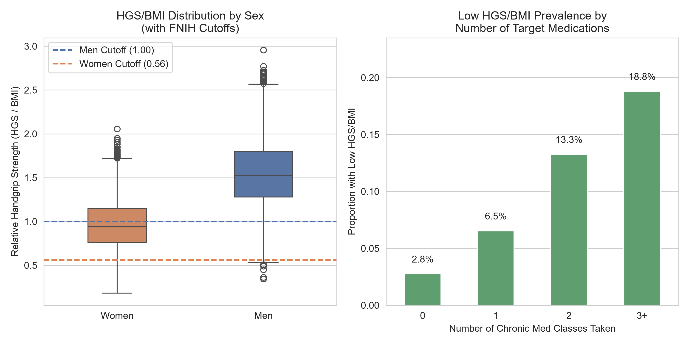

Predicting Low Relative Handgrip Strength from Chronic Medication Interactions in NHANES

**Team Members:** Amit Feldman, Steven Teppe, Anastasia Monogrov

1\. Dataset

**Source:** National Health and Nutrition Examination Survey (NHANES), 2011-2014 cycles (files downloaded: DEMO, BMX, MGX, RXQ_RX, RXQ_DRUG).

- **Analytical Sample Size:** N = 6,421 adults aged 40+ with complete handgrip strength, BMI, and prescription medication records.
- **Key Variables:**
  - **Outcome:** Low relative handgrip strength (HGS/BMI), defined using the foundation for the National Institutes of Health (FNIH) clinical cutoffs (< 1.00 for men and < 0.56 for women). Overall prevalence in our cohort is 7.2% (462 cases). {We need to verify if we need to stratify by age.}
  - **Predictors:** Four chronic medication classes classified via Multum Lexicon therapeutic codes (Statins, Antihypertensives, Antidiabetics, Corticosteroids), total medication count, and demographic covariates (age, sex, race/ethnicity)

2\. Research Question

"In the NHANES 2011-2014 dataset, does an XGBoost model capturing interactions among four common chronic medication classes, predict low relative handgrip strength (HGS/BMI) in adults aged 40+ with a higher AUROC than a baseline logistic regression model, using demographics, individual medications, and total medication count?"

3\. Literature & Research Gap

| **Field**      | **Paper 1 (Same Data & Outcome Definition)**                                                                                                                   | **Paper 2 (Same Research Domain)**                                                                                                                                  |
| -------------- | -------------------------------------------------------------------------------------------------------------------------------------------------------------- | ------------------------------------------------------------------------------------------------------------------------------------------------------------------- |
| **Title**      | Comparison of grip strength measurements for predicting all-cause mortality among adults aged 20+ years from the NHANES 2011-2014 (_Scientific Reports_, 2024) | Association Between Reduced Handgrip Strength and Commonly Prescribed Medications (_medRxiv_, 2020)                                                                 |
| **Question**   | Which grip strength measure (raw HGS, HGS/BMI, etc.) best predicts all-cause mortality in US adults?                                                           | Are polypharmacy and common chronic medications linked to lower handgrip strength in adults?                                                                        |
| **Data**       | NHANES 2011-2014 (9,583 adults aged 20 or older)                                                                                                               | NHANES 2011-2012 only (4,566 adults aged 30 years or older)                                                                                                         |
| **Method**     | Survival analysis (Cox models) comparing 5 continuous grip strength ratios (including HGS/BMI) and 3 low-strength cutoffs (including FNIH criteria)            | Multivariable linear regression adjusted for age, sex, height, arm size, and BMI, testing medication count and individual drug classes                              |
| **Validation** | Internal survival follow-up using linked national mortality records (NDI)                                                                                      | Cross-sectional analysis on the same 2011-2012 sample (no train/test split)                                                                                         |
| **Result**     | Low grip strength strongly predicts mortality (HR = 2.20 in men, 2.52 in women; max AUC = 0.714), and HGS/BMI works well to identify high-risk patients        | Taking more medications lowers grip strength (p < 0.001); statins, blood pressure drugs (ACEi, ARBs, CCBs, diuretics), and sulfonylureas were linked to weaker grip |
| **Left Open**  | Looks at mortality risk, not which medications or drug combinations associated with low HGS/BMI                                                                | Used only 2011-2012 data, tested each drug class separately with linear models, and did not check drug-drug interactions or clinical low HGS/BMI cutoffs            |

**Research Gap:** Previous studies tested chronic medications one by one using linear models on raw grip strength. They did not test whether non-linear interactions between multiple co-prescribed drugs better predict clinically low relative grip strength (HGS/BMI).

4\. Approach

- **Methods:** Train an XGBoost classifier on demographics (age, sex, race/ethnicity), binary chronic medication indicators, and total medication count to capture non-linear drug-drug interactions, using SHAP values to interpret key combinations.
- **Baseline:** Logistic Regression trained on the same demographic features, individual binary medication indicators, and total chronic medication count.
- **Validation:** Stratified 80/20 train-test split by participant ID (SEQN) prior to preprocessing to prevent data leakage. Model performance will be evaluated on the held-out test set using AUROCand AUPRC.

5\. Timeline (Weekly Milestones)

- **Week 7 (2 Dec):** Complete data cleaning, verify medication grouping, and explore drug combinations in the dataset.
- **Week 8 (9 Dec):** Split the data into train/test sets and build the baseline Logistic Regression model.
- **Week 9 (16 Dec):** Train the XGBoost model and compare AUROC/AUPRC scores against the baseline.
- **Week 10 (23 Dec):**Run SHAP to check key drug interactions and test that the code works properly.
- **Week 11 (30 Dec):**Organize the GitHub files, write a short results summary, and submit the project.
#טבלת הסיכום

| Group | N | Age (Mean ± SD) | BMI (Mean ± SD) | HGS/BMI (Mean ± SD) | Low HGS/BMI (%) | Statins (%) | Antihypertensives (%) | Antidiabetics (%) | Corticosteroids (%) |
| :--- | :--- | :--- | :--- | :--- | :--- | :--- | :--- | :--- | :--- |
| **Total Sample (40+)** | 6,421 | 59.1 ± 12.0 | 29.3 ± 6.9 | 1.24 ± 0.45 | 7.2% (462) | 27.8% | 44.8% | 16.4% | 2.2% |
| **Men** | 3,129 | 59.2 ± 12.0 | 28.7 ± 5.8 | 1.54 ± 0.39 | 8.0% (251) | 29.6% | 43.6% | 17.3% | 1.9% |
| **Women** | 3,292 | 59.0 ± 12.1 | 30.0 ± 7.6 | 0.96 ± 0.29 | 6.4% (211) | 26.0% | 46.0% | 15.6% | 2.5% |

**ממצאים ראשוניים (EDA):**
מדגם המחקר הסופי שלנו כולל **6,421 נבדקים בני 40 ומעלה** מתוך מחזורי NHANES 2011–2014, כאשר **7.2% מהם (462 נבדקים)** עומדים בהגדרה הקלינית של FNIH לכוח אחיזת יד יחסי נמוך (`HGS/BMI < 1.00` לגברים ו-`< 0.56` לנשים). כפי שניתן לראות בגרף, שכיחות חולשת השרירים עולה בחדות ככל שמספר קבוצות התרופות הכרוניות הנלקחות במקביל גדל — מ-**2.8%** בקרב נבדקים שאינם נוטלים אף אחת מהתרופות הללו, ל-**6.5%** (תרופה אחת), **13.3%** (2 תרופות), ועד **18.8%** בקרב מי שנוטלים 3 קבוצות תרופות או יותר. מגמת עלייה חדה זו מחזקת את הצורך לבדוק האם אינטראקציות לא-ליניאריות בין סוגי תרופות ספציפיים (באמצעות מודל XGBoost) משפרות את יכולת הניבוי מעבר לספירת תרופות פשוטה ולמודלים ליניאריים.

**Initial Exploratory Findings:**
Our final analytical cohort includes **6,421 adults aged 40+** from the NHANES 2011–2014 cycles, with an overall prevalence of **7.2% (462 cases)** meeting the FNIH clinical criteria for low relative handgrip strength (`HGS/BMI < 1.00` for men and `< 0.56` for women). As shown in the figure above, the prevalence of low `HGS/BMI` increases sharply with concurrent use of our target chronic medication classes—rising from **2.8%** among individuals taking none of these medications to **6.5%** (1 class), **13.3%** (2 classes), and **18.8%** (3+ classes). This steep upward trend provides strong preliminary motivation to investigate whether non-linear interactions between specific drug classes (modeled via XGBoost) improve risk prediction beyond simple medication counts and linear models.

